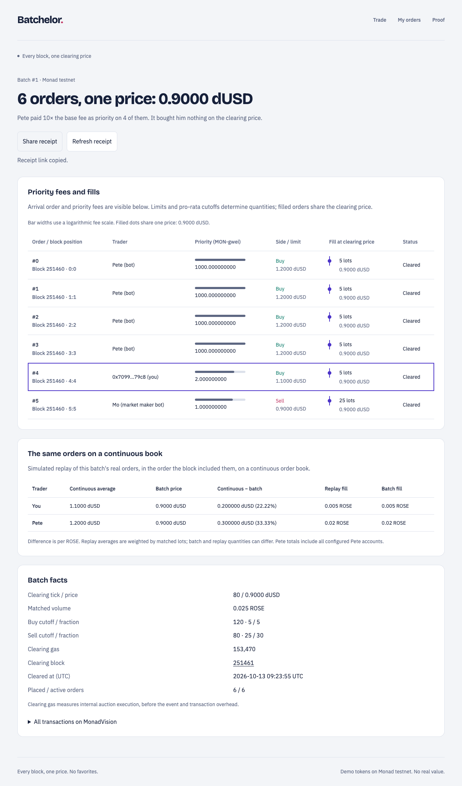

# Batchelor

A professional batch-auction trading terminal for Monad. The initial scaffold intentionally has **no fabricated market data and no simulated trades**.

Batchelor is a fully onchain batch auction where everyone in a block gets the same price, and Monad's new page-based storage makes it cheap enough to clear every block.

The S1–S8 implementation includes the auction, Mera passkey accounts, gasless intents, controlled bots, Envio history, shareable receipts, exact continuous-book replay and measured proof. **The public mainnet demo is not yet deployed.** Mainnet contract addresses, permanent production domain, hosted services, physical-phone onboarding, public GIF/video and submission remain release gates. Local testing and diagnostic testnet transactions are identified separately throughout the repo.



This screenshot is from a local MonadTen rehearsal, not a public mainnet recording. A demo GIF and live link will be added after the production recording gate passes. [Recording script](09_DEMO_SCRIPT.md) · [Submission draft](10_SUBMISSION.md) · [S8 verification/status](docs/S8_REPORT.md).

## Try it in 60 seconds

On the eventual production domain: create a passkey account, get 100 ROSE and 100 dUSD, choose a buy limit/amount, place a gasless order, and open its batch receipt. You need no wallet extension, seed phrase or MON. The receipt shows the real orders, their priority fees, one clearing price and an explicitly simulated continuous-book comparison. Fresh-device completion under 60 seconds three times on mainnet is still pending; mocked passkey tests do not establish device support.

## Three measured headline numbers

| Full book: 256 ticks per side, 512 ladder slots | Result |
|---|---:|
| MonadNine clearing | 4,436,713 gas |
| MonadTen clearing, same bytecode | 342,713 gas |
| Reduction | 12.946× |

These are generated from [bench.json](packages/core/src/bench.json), not estimates. `clearGas` measures `_clear`, excluding telemetry/event and intrinsic transaction gas. Clients reserve measured worst-case self-clear budgets: 586,000 gas for a direct order and 633,000 for a relayed order. The 250K clearing target remains unmet. A separate real testnet 128-tick-per-side batch emitted 213,565 gas, matching its local fixture exactly; [transaction evidence](contracts/bench/out/clear-live-testnet.json) is diagnostic, not the public demo. [Why Monad](docs/WHY_MONAD.md) explains page layout, limit billing, block timing and the precise ordering guarantee.

## Architecture

```text
                         Monad (mainnet 143 / testnet 10143)
                    BatchAuction · ROSE · dUSD · Faucet
                       ▲              ▲              │ events
                  signed intents   direct bot calls   ▼
Web / Mera ───► /api/relay/drip ──► keeper · Mo · Pete  Envio HyperIndex
  │                /api/wake ───► conductor            │ GraphQL
  ├── RPC / WS: live block-pinned ladder               │
  └──────────────── receipts / history / statistics ◄──┘
            packages/core: ABI, addresses, gas, settlement, replay
```

Matching and settlement are onchain. The first transaction after sealing clears the previous batch before writing a new one; the keeper supplies a transaction during idle periods. Mo wakes for 90 seconds after activity. Pete sends four priority-fee buys per block only when explicitly unleashed. Envio drives receipt/history features; there is no product database or AI matching engine.

## Run locally

Use Node **24.19.0**, pnpm **9.15.9**, Foundry **v1.8.0**, Solidity **0.8.28**. The supplied Node 22 pin is superseded by Mera 0.2.0's Node >=24 requirement. Clone with submodules.

```sh
pnpm i --frozen-lockfile
cd contracts
forge build
forge test
cd ..
pnpm proof:tests
pnpm dev
# Reproduce both-hardfork gas evidence:
bash contracts/bench/run.sh
```

The web builds without keys and shows honest unavailable/unconfigured states. Copy `.env.example` into ignored service env files to configure services; put web PUBLIC variables in `apps/web/.env` or hosting settings. Select the permanent `PUBLIC_RP_ID` before onboarding. Private server `CHAIN`/`MARKET_ADDRESS` must mirror public configuration. [Bot runbook](services/bots/README.md), [indexer guide](indexer/README.md), [operations](docs/OPERATIONS.md).

## Quality and security

```sh
pnpm proof:tests              # 81 contract tests/predicates, source/runtime/layout gates
pnpm check:contracts
pnpm check:gas
pnpm gen
pnpm -r typecheck
pnpm -r lint
pnpm -r test
pnpm test:tooling
pnpm -r build
pnpm check:security           # Requires slither-analyzer==0.11.5
pnpm check:secrets            # Requires Gitleaks, full reachable Git history
pnpm web:test-local          # Real endpoints on a temporary loopback MonadTen chain
pnpm receipts:test-local     # Real local transactions through actual Envio handlers
```

CI also runs formatting, size checks, historical MonadNine tests, repeated benchmarks, generated ABI/gas/vector freshness and contrast checks. `lint` means strict TS/Svelte diagnostics. The proof exporter requires ≥1,000 fuzz runs and 256 invariant runs at depth 200. Slither's 23 findings are individually justified; new findings or changed source hashes fail the gate. The exact source/opcode check forbids gasprice, coinbase, prevrandao and blockhash inputs. Secret scanning has only a narrowly shaped source-hash false-positive exception. [Security review](docs/SECURITY.md) describes scope and risks; this is not an independent audit.

## Deployments and receipts

**Mainnet:** BatchAuction, ROSE, dUSD and Faucet are unset in [generated addresses](packages/core/src/addresses.ts). **Public demo testnet:** also unset. The separate S3 testnet diagnostic addresses/tx hashes remain in [live proof evidence](contracts/bench/out/clear-live-testnet.json). Successful broadcast receipts, never dry-run predictions, populate public addresses through `pnpm gen`.

`/b/[id]` renders an indexed receipt and data-generated PNG preview; `/me` shows balances/orders/withdrawal; `/proof` shows benchmark evidence, eight economic gates and the latest available indexed gas sample. Actor addresses configure honest Pete/Mo labels. Missing endpoints are shown as unavailable rather than mocked history. Contract source-verification status remains pending.

`pnpm deploy:plan`, `pnpm funding:plan` and `pnpm verify:bundle` prepare reviewable calls, budgets and compiler sources. They do not publish or fund services. Mainnet calls/costs must be approved before sending; read-only budget tools require no spending approval.

## Limitations

Orders last one batch; there are no resting GTC orders, multiple markets, fees, real-asset markets, or price oracle. Demo tokens have no real value. Liquidity is supplied by a bot that sleeps between visits. Rounding dust stays in the contract. Same-price/permutation proofs apply to accepted orders within one batch; fees can still influence inclusion and which batch an order reaches. Quantities and tiny-order effective rates can differ because of cutoffs and rounding. No mempool privacy is promised. Continuous replay is hypothetical and excludes cancelled orders whose cancellation timing is not indexed.

In-memory relay quotas/queues and Pete caps reset with processes and do not enforce global multi-instance limits. Hosted reliability, RPC capacity, funding and physical passkey-provider support need real release verification. [Design](docs/DESIGN.md) describes the mechanism, rounding and v2 resting-order ideas; [operations](docs/OPERATIONS.md) records recovery/funding policies.

## AI assistance and provenance

OpenAI **Codex** drafted code, tests, tooling, UI and documentation under Rahul's direction. Rahul supplied the uncrossing, rounding, invariant and storage specifications. Automated/reference/manual agent reviews are recorded; Rahul's independent line-by-line sign-off remains a release gate. **The product uses no AI at runtime.** [Component disclosure](docs/AI_DISCLOSURE.md) gives the breakdown. Original project code began in this repository during the 12–13 October 2026 build; [commit evidence](docs/verification/s8-commits.json) records its history.

Project code is [MIT](LICENSE). Third-party notices remain applicable: OpenZeppelin/forge-std, viem, SvelteKit, Hono, Zod, Tailwind and scure are MIT; Mera is MIT OR Apache-2.0; brand fonts use SIL OFL. Envio 3.14.0 has its own generator/generated-code licensing terms and is not represented as MIT or OSI licensed. See its installed `licenses/README.md` and [sources](docs/SOURCES.md).
## Requirements
- Node.js 20.9+
- npm

## Run locally
```bash
npm install
npm run dev
```
Open http://localhost:3000.

## Architecture
- `src/app/`: route and global styling
- `src/components/terminal/`: presentation-only terminal components
- `src/lib/market-data/`: typed data contract and adapter boundary
- `src/types/`: domain types

The initial adapter returns `unavailable`, not invented prices or orders. Replace it when the backend/API, contract addresses, ABI and event/indexing strategy are agreed.

## Before connecting real data
Confirm:
1. Monad network (testnet or mainnet) and chain ID.
2. Market pair and token addresses/decimals.
3. Source of truth for order book and batch state (contract reads, events, indexer/API).
4. Clearing-price and partial-fill rules.
5. Transaction confirmation/finality behavior and explorer URL.

## Design direction
Trading information density follows professional exchange terminals; charting is reserved for actual sourced OHLCV data. Do not copy Kraken or TradingView branding/assets.
